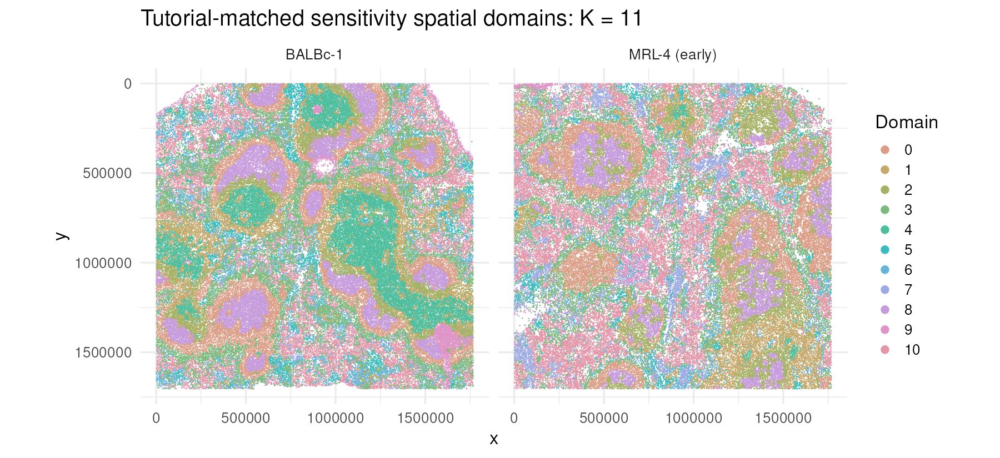

# CellCharterR

[](https://github.com/cperalta-viteri/CellCharterR/actions/workflows/R-CMD-check.yaml)
[](https://github.com/cperalta-viteri/CellCharterR/actions/workflows/R-CMD-check.yaml)
[](tests/testthat/test-torch-kmeans-initializer.R)
[](https://github.com/cperalta-viteri/CellCharterR/actions/workflows/R-4.5-compat.yaml)
[](https://github.com/cperalta-viteri/CellCharterR/actions/workflows/R-4.4-compat.yaml)

## Introduction

CellCharter identifies spatial domains in spatial-omics data by combining each
cell's molecular representation with the composition of its local
neighbourhood. It builds spatial graphs, aggregates multi-hop neighbourhood
features, fits full-covariance Gaussian mixture models, and uses cluster
stability to select the number of domains. CellCharterR implements the
post-representation CellCharter workflow natively in R, including enrichment
and differential neighbourhood analyses. It accepts an existing embedding and
does not reimplement the upstream scVI or trVAE representation model.

References: [Varrone et al., *Nature Genetics* (2024)](https://doi.org/10.1038/s41588-023-01588-4);
[CellCharter source](https://github.com/CSOgroup/cellcharter);
[CellCharter documentation](https://cellcharter.readthedocs.io/).

> **Independent implementation:** CellCharterR is an independent R
> implementation of methods described by the CellCharter project. It is not
> affiliated with, endorsed by, or maintained by the original CellCharter
> authors or the Computational Systems Oncology group. Questions and bug
> reports concerning CellCharterR should be directed to the
> [CellCharterR repository](https://github.com/cperalta-viteri/CellCharterR/issues),
> not to the upstream CellCharter project.

## Motivation

The Bioconductor ecosystem provides a high-performance foundation for
single-cell analysis centred on `SingleCellExperiment` and its spatially aware
subclass `SpatialExperiment`. These interoperable containers work with
`DelayedArray` and `HDF5Array`, allowing assays and
intermediate representations to remain on disk instead of requiring the whole
dataset in memory. Implementing the CellCharter workflow in R lets large
spatial datasets benefit from this infrastructure while remaining compatible
with native Bioconductor annotation, visualization, testing, and statistical
tools. CellCharterR therefore uses an SPE-first interface (while retaining SCE
compatibility), sample-local graph processing, disk-backed checkpoints,
bounded-memory prediction, and batched R Torch computation.

Reference: [Amezquita et al., *Nature Methods* (2020)](https://doi.org/10.1038/s41592-019-0654-x).

### Full mouse-spleen K=11 sensitivity



The preserved full-data report shows the normal BALBc-1 slide beside the early
lupus MRL-4 slide. K=11 matches the original tutorial and is reported only as a
sensitivity analysis; the independent R AutoK primary result is K=4.

## Citation

If you use this implementation, please cite CellCharterR and the original
CellCharter method. Copy-ready text and BibTeX are provided in
[`inst/CITATION.md`](inst/CITATION.md); an installed package also provides
`citation("CellCharterR")`.

## Vignettes and reports

- [Beginner SPE-first workflow](https://cperalta-viteri.github.io/CellCharterR/docs/CellCharterR-beginner-workflow.html)
  runs K=2 through K=10 on the packaged 1,000-cell teaching object, on CPU.
- [H5AD download and SPE conversion](https://cperalta-viteri.github.io/CellCharterR/docs/CellCharterR-h5ad-to-sce.html)
  shows checksum-verified download and conversion code without executing the
  full download during package builds.
- [Full CODEX mouse-spleen reproducibility report](https://cperalta-viteri.github.io/CellCharterR/docs/CellCharterR-mouse-spleen-reproducibility.html)
  is the preserved, precomputed full-data report. It is not rerun during build,
  check, examples, or CI.

## Installation

```r
if (!requireNamespace("BiocManager", quietly = TRUE)) {
  install.packages("BiocManager")
}
# Make both Bioconductor and CRAN dependencies visible to the installer.
options(repos = BiocManager::repositories())

# R torch is distributed through CRAN, not Bioconductor.
install.packages("torch")

# Install the Linux CPU LibTorch runtime. Restart R if prompted.
torch::install_torch(type = "cpu")

if (!requireNamespace("remotes", quietly = TRUE)) {
  install.packages("remotes")
}
remotes::install_github(
  "cperalta-viteri/CellCharterR",
  build_vignettes = TRUE,
  dependencies = TRUE
)

library(CellCharterR)
torch_gmm_device("cpu")
```

See [INSTALL](INSTALL) for the supported Linux CPU target and smoke test.

### Importing a large H5AD on R 4.4

`cellcharter_import_h5ad()` does not require Python, `anndataR`, reticulate, or
zellkonverter. It makes a resumable byte-for-byte clone so the resulting SPE is
independent of the source H5AD while its large arrays remain on disk:

```r
bundle <- "TCGA_OSCC_DeepSpotM_FFPE_merged_spe"
spe <- cellcharter_import_h5ad(
  "TCGA_OSCC_DeepSpotM_FFPE_merged.h5ad",
  output_dir = bundle
)
```

The complete bundle directory is the portable object. After moving it, reload
and automatically rebase its HDF5 paths with:

```r
spe <- cellcharter_load_spe_bundle(bundle)
```

The source H5AD is never deleted. A full independent bundle requires equivalent
free disk space; interrupted copies resume from `arrays.h5.partial`.

### Saving a completed large analysis

After graph construction, aggregation, clustering, and enrichment, export a
self-contained completed-analysis directory. Large assays and embeddings are
written blockwise to bundle-owned HDF5 files; graphs, models, results,
parameters, and other lightweight state are stored separately:

```r
# With filepath = NULL, the aggregated representation is stored in the SPE.
spe <- cellcharter_aggregate(
  spe,
  representation = "PCA",
  graph_name = "cellcharter_graph",
  n_layers = 3L,
  output = "X_cellcharter"
)

# Run clustering and downstream analyses, then export the complete state.
cellcharter_save_analysis_bundle(
  spe,
  output_dir = "oscc_complete_analysis",
  progress = TRUE
)
```

The export validates file sizes, SHA-256 checksums, dimensions, ordering, and
object validity before atomically publishing the directory. It also copies and
rebases CellCharterR-owned AutoK checkpoints, so the exported analysis no
longer depends on the original H5AD, conversion bundle, or checkpoint path.

```text
oscc_complete_analysis/
├── manifest.rds
├── manifest.sha256
└── object/
    ├── structure.rds
    └── *.h5
```

The directory can be moved, renamed, or archived with an external tool. Load it
from its new location with:

```r
spe <- cellcharter_load_analysis_bundle("oscc_complete_analysis")
methods::validObject(spe)
```

Copy or archive the entire directory, not individual files. The loader rejects
missing or modified payloads before returning an incomplete object. Unsupported
opaque third-party metadata references and externally backed spatial images
are rejected during saving with an actionable location rather than silently
producing a non-portable analysis.

## Why the GMM uses Torch directly

The GMM is an expectation-maximisation (EM) algorithm. Its E-step evaluates
Gaussian probabilities and its M-step has closed-form weighted means and
covariances. These are large matrix operations, so this implementation uses
R Torch tensors. The supported package examples and checks run on Linux CPU. A
neural-network training framework is not used in the inner loop because EM has
closed-form parameter updates.

The GMM never materialises the whole feature matrix. Each iteration:

1. reads an HDF5/DelayedArray row chunk;
2. transfers the chunk to CPU/GPU Torch memory;
3. calculates responsibilities and sufficient statistics;
4. releases the chunk and advances to the next one;
5. updates only the small K-by-P means and K P-by-P covariance matrices.

For CUDA analyses, opt into the full-data Torch initializer and automatic
batch sizing. `cellcharter_cluster_fixed()` fits exactly one K and therefore
does not expand it into the neighbouring models required by AutoK:

```r
spe <- cellcharter_cluster_fixed(
  spe,
  representation = "X_cellcharter",
  n_clusters = 12L,
  domain_col = "cellcharter_k12",
  checkpoint_dir = "checkpoints/fixed_k12_gpu",
  seed = 42L,
  fit_args = list(
    device = "cuda",
    batch_size = "auto",
    initialization_method = "torch"
  ),
  predict_args = list(device = "cuda", batch_size = 131072L)
)
```

The accelerated initializer uses the complete dataset; it is not mini-batch or
sampled K-means. Use a new checkpoint directory when switching numerical
engines. The original `initialization_method = "legacy"` path remains available.

## Minimal example

```r
library(CellCharterR)
spe <- cellcharter_mouse_spleen_tiny()

# Build the spatial graph from native coordinates and aggregate one hop.
spe <- cellcharter_graph(spe)
spe <- cellcharter_aggregate(spe, n_layers = 1L)
SpatialExperiment::spatialCoordsNames(spe)
SingleCellExperiment::reducedDimNames(spe)
```

### Where results are stored

CellCharterR keeps each result inside the same `SpatialExperiment`, using the
standard Bioconductor component appropriate for that result:

| Result | Location in `spe` | Default name |
|---|---|---|
| Spatial coordinates | `SpatialExperiment::spatialCoords(spe)` | `x`, `y` |
| Trimmed sample-local graph | `SingleCellExperiment::colPair(spe, ...)` | `cellcharter_graph` |
| Aggregated neighbourhood features | `SingleCellExperiment::reducedDim(spe, ...)` | `X_cellcharter` |
| Selected domain labels | `SummarizedExperiment::colData(spe)` | `cellcharter_domain` |
| AutoK fits and stability | `S4Vectors::metadata(spe)$CellCharterR$autok` | domain-column name |
| Enrichment and proximity results | `S4Vectors::metadata(spe)$CellCharterR$results` | analysis name |
| Parameters and cell-order provenance | `S4Vectors::metadata(spe)$CellCharterR$stages` | stage name |

The available fields can be inspected without realizing disk-backed assays:

```r
SingleCellExperiment::colPairNames(spe)
SingleCellExperiment::reducedDimNames(spe)
colnames(SummarizedExperiment::colData(spe))
names(S4Vectors::metadata(spe)$CellCharterR)
```

Subsetting an SPE automatically remaps its `colPairs`; CellCharterR detects
identity-sensitive stage records as stale so derived representations are not
silently reused after cell removal or reordering.

## Reproducing the official tutorial analyses

Download the checksum-pinned public inputs, then run the checkpointed workflow:

```bash
Rscript scripts/download_codex_mouse_spleen.R
Rscript scripts/run_codex_mouse_spleen.R
```

By default, inputs and durable stage checkpoints live under
`results/codex_mouse_spleen/`. Set `CODEX_INPUT_DIR` or `CODEX_RESULTS_DIR` to
use another layout. `CODEX_STAGES` can resume any comma-separated subset of
`representation,graph,aggregation,autok,downstream,report`.

The primary path treats the official trVAE representation as immutable input,
rebuilds sample-local Delaunay graphs with R Qhull, and follows pinned
CellCharter 0.2.0 by applying one global 99th-percentile link cutoff. The
released H5AD instead reflects a separate 99th-percentile cutoff within each
sample. The workflow saves both variants: the global graph drives primary
inference, while the R per-sample reconstruction is verified edge-for-edge
against the published adjacency and reproduces the official 40-dimensional
aggregate. This source-versus-artifact discrepancy is visible in the manifest
and report rather than silently selecting whichever path matches.

AutoK declares candidate `K = 2..20` in advance, fits the expanded `K = 1..21`
grid with at most 10 repeated full-covariance R Torch fits, and uses the
CellCharter 0.2.0 neighboring-K Fowlkes–Mallows rule. The independently selected
K drives all primary maps and statistics. K = 11 is kept only as a separately
labelled tutorial sensitivity analysis. Generated data and checkpoints are
ignored by Git and excluded from the source package.

The second-review Phase-0 K=4/K=11 deliverables are generated with:

```bash
Rscript scripts/build_second_review_deliverables.R
Rscript -e 'rmarkdown::render("reports/CellCharterR_mouse_spleen_AutoK_K11.Rmd", output_dir="results/CellCharterR_mouse_spleen_v2/report")'
```

They are stored under `results/CellCharterR_mouse_spleen/`. The original
`results/codex_mouse_spleen/` tree is retained as the immutable first-round
checkpoint bundle on which these recomputed downstream analyses depend.

The permanent K=11 prediction fixture in `inst/extdata/` was generated from
the pinned PyCave model and exact published aggregate with:

```bash
Rscript scripts/build_python_gmm_fixture.R
```

That one-time fixture builder uses the Python standard library only to decode
the official PyTorch archive; Python is not a CellCharterR runtime dependency.

The CosMx workflow follows the official tutorial's supplied scVI representation
but deliberately rebuilds sample-local graphs and three-hop niche features in R:

```bash
COSMX_H5AD=/path/to/cosmx_human_nsclc_clustered.h5ad \
  Rscript scripts/run_cosmx_human_nsclc.R
Rscript -e 'rmarkdown::render("inst/rmarkdown/cosmx_human_nsclc_report.Rmd")'
```
