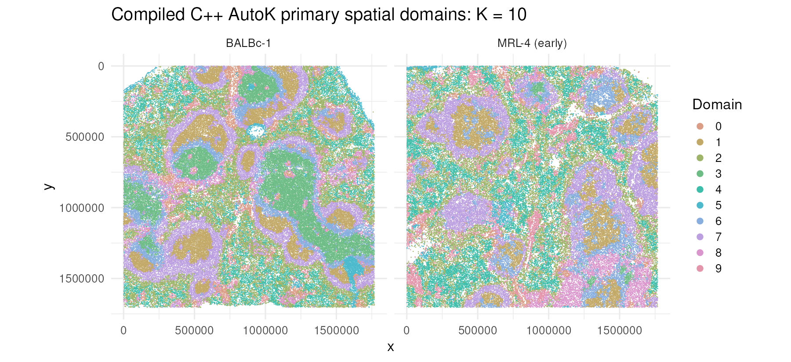

# CellCharterR

[](https://github.com/cperalta-viteri/CellCharterR/actions/workflows/R-CMD-check.yaml)
[](https://github.com/cperalta-viteri/CellCharterR/actions/workflows/R-CMD-check.yaml)
[](tests/testthat/test-torch-kmeans-initializer.R)
[](https://github.com/cperalta-viteri/CellCharterR/actions/workflows/R-4.5-compat.yaml)
[](https://github.com/cperalta-viteri/CellCharterR/actions/workflows/R-4.4-compat.yaml)

## Introduction

CellCharter identifies spatial domains in spatial-omics data by combining each
spatial observation's molecular representation with the composition of its local
neighbourhood. It builds spatial graphs, aggregates multi-hop neighbourhood
features, fits full-covariance Gaussian mixture models, and uses cluster
stability to select the number of domains. CellCharterR implements the
post-representation CellCharter workflow natively in R, including enrichment
and differential neighbourhood analyses. It accepts an existing embedding and
does not reimplement the upstream scVI or trVAE representation model.

References: [Varrone et al., *Nature Genetics* (2024)](https://doi.org/10.1038/s41588-023-01588-4);
[CellCharter source](https://github.com/CSOgroup/cellcharter);
[CellCharter documentation](https://cellcharter.readthedocs.io/).

> **Independent implementation:** CellCharterR is an independent R
> implementation of methods described by the CellCharter project. It is not
> affiliated with, endorsed by, or maintained by the original CellCharter
> authors or the Computational Systems Oncology group. Questions and bug
> reports concerning CellCharterR should be directed to the
> [CellCharterR repository](https://github.com/cperalta-viteri/CellCharterR/issues),
> not to the upstream CellCharter project.

## Motivation

The Bioconductor ecosystem provides a high-performance foundation for
single-cell analysis centred on `SingleCellExperiment` and its spatially aware
subclass `SpatialExperiment`. These interoperable containers work with
`DelayedArray` and `HDF5Array`, allowing assays and
intermediate representations to remain on disk instead of requiring the whole
dataset in memory. Implementing the CellCharter workflow in R lets large
spatial datasets benefit from this infrastructure while remaining compatible
with native Bioconductor annotation, visualization, testing, and statistical
tools. CellCharterR therefore uses an SPE-first interface (while retaining SCE
compatibility), sample-local graph processing, disk-backed checkpoints,
bounded-memory prediction, a compiled multicore C++ CPU GMM, and an optional R
Torch backend.

> **Clustering status:** the compiled C++17 CPU GMM/AutoK backend is the
> supported and recommended CellCharterR clustering path. It can fit candidate
> K values concurrently and has a deterministic single-worker fallback. The R
> Torch CPU/CUDA backend is retained for parity work and specialized hardware,
> but remains experimental for multi-million-observation datasets. Users may
> also compute domains with Python CellCharter and store labels directly in the
> SPE's `colData` or in a one-column `reducedDim`; all supported downstream R
> functions accept that handoff.

Reference: [Amezquita et al., *Nature Methods* (2020)](https://doi.org/10.1038/s41592-019-0654-x).

### Full mouse-spleen compiled-C++ domains



The independently selected compiled-C++ AutoK result is K=10. Other local
stability peaks remain visible in the full report, so domain resolutions can
also be inspected as biological sensitivity analyses.


K=11 matches the original tutorial resolution and is reported separately as a
sensitivity fit. Both images show the normal BALBc-1 slide beside the early
lupus MRL-4 slide using labels from the completed compiled-C++ analysis.

## Citation

If you use this implementation, please cite CellCharterR and the original
CellCharter method. Copy-ready text and BibTeX are provided in
[`inst/CITATION.md`](inst/CITATION.md); an installed package also provides
`citation("CellCharterR")`.

## Vignettes and reports

For a conceptual path, read beginner → full reproduction → downstream. For a
local large-data analysis, read beginner → H5AD-to-SPE → full reproduction →
downstream.

1. [Beginner workflow: finding spatial domains](https://cperalta-viteri.github.io/CellCharterR/docs/CellCharterR-beginner-workflow.html)
   explains the SPE structure, sample-local graph, neighborhood aggregation,
   clustering, stability diagnostics, and downstream statistics on a small
   CPU-safe teaching object.
2. [Full compiled-C++ mouse-spleen reproduction](https://cperalta-viteri.github.io/CellCharterR/docs/CellCharterR-mouse-spleen-reproducibility.html)
   preserves the complete graph, aggregation, compiled C++ AutoK, independently
   selected K=10 result, and compiled C++ K=11 sensitivity analysis. Expensive
   stages are loaded from validated artifacts rather than recomputed in CI.
3. [Additional downstream analysis](https://cperalta-viteri.github.io/CellCharterR/docs/CellCharterR-differential-neighborhood-networks.html)
   shows H5AD-to-SPE organization, detailed assigned cell-type enrichment,
   healthy and lupus neighborhood heatmaps, differential analysis, and directed
   graph visualization from the preserved compiled C++ K=10 result.
4. [Large-data H5AD-to-SPE workflow](https://cperalta-viteri.github.io/CellCharterR/docs/CellCharterR-h5ad-to-sce.html)
   covers independent disk-backed SPE directories and the checksum-verified
   CODEX conversion without downloading large inputs during package builds.

## Installation

```r
if (!requireNamespace("BiocManager", quietly = TRUE)) {
  install.packages("BiocManager")
}
# Make both Bioconductor and CRAN dependencies visible to the installer.
options(repos = BiocManager::repositories())

if (!requireNamespace("remotes", quietly = TRUE)) {
  install.packages("remotes")
}
remotes::install_github(
  "cperalta-viteri/CellCharterR",
  build_vignettes = TRUE,
  dependencies = NA
)

library(CellCharterR)
```

The compiled CPU backend, H5AD/SPE import, and downstream analyses do not need
R Torch. The experimental Torch backend is optional; install it separately with
`install.packages("torch")` only when you explicitly intend to use that backend.
Loading a current or legacy SPE does not initialize Torch or download LibTorch.

See [INSTALL](INSTALL) for the supported Linux CPU target and smoke test.

### Importing a large H5AD on R 4.4

`cellcharter_import_h5ad()` does not require Python, `anndataR`, reticulate, or
zellkonverter. It makes a resumable byte-for-byte clone so the resulting SPE is
independent of the source H5AD while its large arrays remain on disk:

```r
spe_dir <- "TCGA_OSCC_DeepSpotM_FFPE_merged_spe"
spe <- cellcharter_import_h5ad(
  "TCGA_OSCC_DeepSpotM_FFPE_merged.h5ad",
  output_dir = spe_dir
)
```

The complete AnnData hierarchy is retained in the independent `arrays.h5`.
The importer maps `obs` and `var` to `colData` and `rowData`; the requested
spatial coordinates, PCA, CellCharter, and AUCell entries to SPE coordinates
and `reducedDims`; and every supported sparse `obsp` entry to a same-named
weighted `colPair`. In particular, `spatial_connectivities` and
`spatial_distances` are imported with their stored values, so downstream
analysis reuses the original graph without rebuilding it. Potentially large
`uns` content remains in `arrays.h5` and is indexed from SPE metadata rather
than being copied into memory.

The complete saved directory is the portable object. After moving it, reload
and automatically rebase its HDF5 paths with:

```r
spe <- cellcharter_load_spe(spe_dir)
```

The source H5AD is never deleted. A full independent copy requires equivalent
free disk space; interrupted copies resume from `arrays.h5.partial`.

### Saving a completed large analysis

After graph construction, aggregation, clustering, and enrichment, export a
self-contained completed-analysis directory. Large assays and embeddings are
written blockwise to analysis-owned HDF5 files; graphs, models, results,
parameters, and other lightweight state are stored separately:

```r
# With filepath = NULL, the aggregated representation is stored in the SPE.
spe <- cellcharter_aggregate(
  spe,
  representation = "PCA",
  graph_name = "spatial_connectivities",
  n_layers = 3L,
  output = "X_cellcharter"
)

# Run clustering and downstream analyses, then export the complete state.
cellcharter_save_analysis(
  spe,
  output_dir = "oscc_complete_analysis",
  progress = TRUE
)
```

The export validates file sizes, SHA-256 checksums, dimensions, ordering, and
object validity before atomically publishing the directory. It also copies and
rebases CellCharterR-owned AutoK checkpoints, so the exported analysis no
longer depends on the original H5AD, conversion directory, or checkpoint path.

```text
oscc_complete_analysis/
├── manifest.rds
├── manifest.sha256
└── object/
    ├── structure.rds
    └── *.h5
```

The directory can be moved, renamed, or archived with an external tool. Load it
from its new location with:

```r
spe <- cellcharter_load_analysis("oscc_complete_analysis")
methods::validObject(spe)
```

Copy or archive the entire directory, not individual files. The loader rejects
missing or modified payloads before returning an incomplete object. Unsupported
opaque third-party metadata references and externally backed spatial images
are rejected during saving with an actionable location rather than silently
producing a non-portable analysis.

## Clustering backends

### Compiled multicore CPU backend

CellCharterR provides a supported C++17 full-covariance GMM backend for large
AutoK searches. It is the recommended backend for new CPU analyses. On the full
mouse-spleen aggregated representation (707,474 spatial spots and 40
features), an AutoK search over candidate `K = 2..20`
converged after five rounds in **38 minutes 20 seconds** on Linux using eight
concurrent fits with four threads per fit. A standalone K=20 fit took 154.5
seconds with four threads and 567.4 seconds with one thread, with identical
labels and negligible floating-point differences. Extrapolating from those
measurements, the same complete five-round search would take approximately
**18--20 hours on one comparable CPU core**; this is an estimate, not a
measured single-core AutoK run.

The preserved before/after workflow comparison uses the same first five AutoK
rounds over the expanded `K = 1..21` grid: 105 GMM fits in total.

| Implementation | Spatial spots | Features | AutoK rounds | Fits | Observed wall time |
|---|---:|---:|---:|---:|---:|
| Previous R Torch CUDA, sequential K fits (RTX A4000) | 707,474 | 40 | 5 | 105 | at least 49 h 47 min 25 s |
| Compiled C++ CPU, 8 workers x 4 threads | 707,474 | 40 | 5 | 105 | 38 min 20 s |

That is an observed wall-time reduction of at least **77.9-fold**. The legacy
duration is a conservative lower bound reconstructed from the first and last
completed checkpoint timestamps, so it omits time before the first checkpoint;
the C++ duration was recorded end to end by the runner. This is a real workflow
comparison, not a controlled microbenchmark: the numerical engines and
initializers differ, so the timing does not imply identical fitted parameters.

Parallel execution uses standard C++17 threads rather than Unix process
forking. It is therefore designed to compile on Linux, macOS, and Windows with
the corresponding R C++ toolchain. The current benchmark and validation are
Linux-only, however, so macOS and Windows multicore behavior should be treated
as unverified until platform-specific CI is added. Runtime will depend on CPU,
memory bandwidth, candidate K range, convergence behavior, and thread count.

```r
spe <- cellcharter_cluster(
  spe,
  representation = "X_cellcharter",
  candidate_k = 2:20,
  checkpoint_dir = "checkpoints/autok_cpp",
  domain_col = "cellcharter_domain",
  max_runs = 10L,
  convergence_tol = 0.01,
  seed = 0L,
  backend = "cpp",
  workers = 8L,
  threads_per_fit = 2L,
  checkpoint_mode = "round",
  resume = TRUE
)
```

Set `workers * threads_per_fit` no higher than the CPU threads and memory
bandwidth available to R. Use `workers = 1L` for sequential execution or when
a platform's multicore behavior has not been validated.

### Experimental R Torch backend

The GMM is an expectation-maximisation (EM) algorithm. Its E-step evaluates
Gaussian probabilities and its M-step has closed-form weighted means and
covariances. These are large matrix operations, so this implementation uses
R Torch tensors. The supported package examples and checks run on Linux CPU. A
neural-network training framework is not used in the inner loop because EM has
closed-form parameter updates.

The GMM never materialises the whole feature matrix. Each iteration:

1. reads an HDF5/DelayedArray row chunk;
2. transfers the chunk to CPU/GPU Torch memory;
3. calculates responsibilities and sufficient statistics;
4. releases the chunk and advances to the next one;
5. updates only the small K-by-P means and K P-by-P covariance matrices.

For CUDA analyses, opt into the full-data Torch initializer and automatic
batch sizing. `cellcharter_cluster_fixed()` fits exactly one K and therefore
does not expand it into the neighbouring models required by AutoK:

```r
spe <- cellcharter_cluster_fixed(
  spe,
  representation = "X_cellcharter",
  n_clusters = 12L,
  domain_col = "cellcharter_k12",
  checkpoint_dir = "checkpoints/fixed_k12_gpu",
  seed = 42L,
  fit_args = list(
    device = "cuda",
    batch_size = "auto",
    initialization_method = "torch"
  ),
  predict_args = list(device = "cuda", batch_size = 131072L)
)
```

The accelerated initializer uses the complete dataset; it is not mini-batch or
sampled K-means. Use a new checkpoint directory when switching numerical
engines. The original `initialization_method = "legacy"` path remains available.

### Continue in R after clustering with Python

Export Python CellCharter labels in the same observation order as the SPE and
store them directly in `colData`:

```r
python_domains <- read.csv("python_cellcharter_domains.csv")
stopifnot(identical(as.character(python_domains$spot_id), colnames(spe)))
spe$cellcharter_domain <- factor(python_domains$domain)
```

The `domain_col` can then be passed unchanged to CellCharterR's enrichment,
neighborhood-enrichment, differential, zonation, and plotting APIs. Those
functions also accept a one-column reducedDim named by `domain_col`, or a named
column inside any unambiguous reducedDim.

## Minimal example

```r
library(CellCharterR)
spe <- cellcharter_mouse_spleen_tiny()

# Build the spatial graph from native coordinates and aggregate one hop.
spe <- cellcharter_graph(spe)
spe <- cellcharter_aggregate(spe, n_layers = 1L)
SpatialExperiment::spatialCoordsNames(spe)
SingleCellExperiment::reducedDimNames(spe)
```

### Where results are stored

CellCharterR keeps each result inside the same `SpatialExperiment`, using the
standard Bioconductor component appropriate for that result:

| Result | Location in `spe` | Default name |
|---|---|---|
| Spatial coordinates | `SpatialExperiment::spatialCoords(spe)` | `x`, `y` |
| Trimmed sample-local graph | `SingleCellExperiment::colPair(spe, ...)` | `cellcharter_graph` |
| Aggregated neighbourhood features | `SingleCellExperiment::reducedDim(spe, ...)` | `X_cellcharter` |
| Selected domain labels | `SummarizedExperiment::colData(spe)` | `cellcharter_domain` |
| AutoK fits and stability | `S4Vectors::metadata(spe)$CellCharterR$autok` | domain-column name |
| Enrichment and proximity results | `S4Vectors::metadata(spe)$CellCharterR$results` | analysis name |
| Parameters and spot-order provenance | `S4Vectors::metadata(spe)$CellCharterR$stages` | stage name |

The available fields can be inspected without realizing disk-backed assays:

```r
SingleCellExperiment::colPairNames(spe)
SingleCellExperiment::reducedDimNames(spe)
colnames(SummarizedExperiment::colData(spe))
names(S4Vectors::metadata(spe)$CellCharterR)
```

Subsetting an SPE automatically remaps its `colPairs`; CellCharterR detects
identity-sensitive stage records as stale so derived representations are not
silently reused after spot removal or reordering.

## Reproducing the official tutorial analyses

Download the checksum-pinned public inputs, then run the checkpointed workflow:

```bash
Rscript scripts/download_codex_mouse_spleen.R
Rscript scripts/run_codex_mouse_spleen.R
```

By default, inputs and durable stage checkpoints live under
`results/codex_mouse_spleen/`. Set `CODEX_INPUT_DIR` or `CODEX_RESULTS_DIR` to
use another layout. `CODEX_STAGES` can resume any comma-separated subset of
`representation,graph,aggregation,autok,downstream,report`.

The primary path treats the official trVAE representation as immutable input,
rebuilds sample-local Delaunay graphs with R Qhull, and follows pinned
CellCharter 0.2.0 by applying one global 99th-percentile link cutoff. The
released H5AD instead reflects a separate 99th-percentile cutoff within each
sample. The workflow saves both variants: the global graph drives primary
inference, while the R per-sample reconstruction is verified edge-for-edge
against the published adjacency and reproduces the official 40-dimensional
aggregate. This source-versus-artifact discrepancy is visible in the manifest
and report rather than silently selecting whichever path matches.

AutoK declares candidate `K = 2..20` in advance, fits the expanded `K = 1..21`
grid with at most 10 repeated full-covariance compiled C++ fits, and uses the
CellCharter 0.2.0 neighboring-K Fowlkes–Mallows rule. The independently selected
K=10 drives all primary maps and statistics. K=11 is kept only as a separately
labelled tutorial sensitivity analysis. Generated data and checkpoints are
ignored by Git and excluded from the source package.

The lightweight downstream artifacts are derived from the completed compiled
C++ run without refitting GMMs or rerunning AutoK:

```bash
Rscript scripts/build_cpp_mouse_spleen_deliverables.R
Rscript -e 'rmarkdown::render("reports/CellCharterR_mouse_spleen_AutoK_K11.Rmd", output_file="CellCharterR-mouse-spleen-reproducibility.html", output_dir="docs")'
```

They are stored under
`results/CellCharterR_mouse_spleen_cpp_v1/report_artifacts/`. The completed
compiled-C++ fit objects remain under `results/CellCharterR_mouse_spleen_cpp_v1/`.

The permanent K=11 prediction fixture in `inst/extdata/` was generated from
the pinned PyCave model and exact published aggregate with:

```bash
Rscript scripts/build_python_gmm_fixture.R
```

That one-time fixture builder uses the Python standard library only to decode
the official PyTorch archive; Python is not a CellCharterR runtime dependency.

The CosMx workflow follows the official tutorial's supplied scVI representation
but deliberately rebuilds sample-local graphs and three-hop niche features in R:

```bash
COSMX_H5AD=/path/to/cosmx_human_nsclc_clustered.h5ad \
  Rscript scripts/run_cosmx_human_nsclc.R
Rscript -e 'rmarkdown::render("inst/rmarkdown/cosmx_human_nsclc_report.Rmd")'
```
